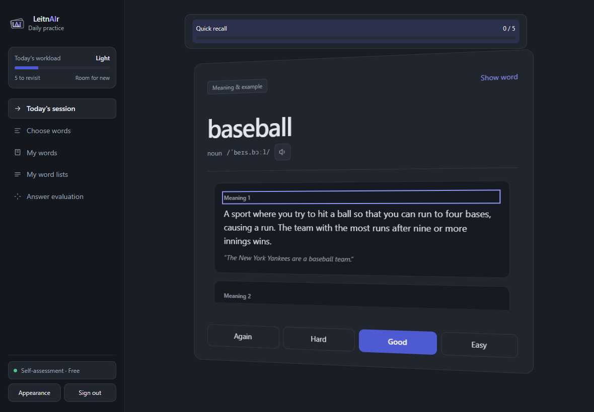
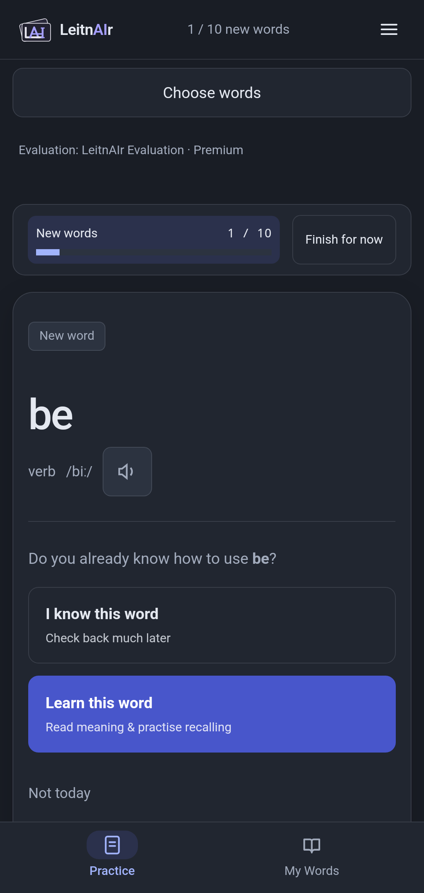
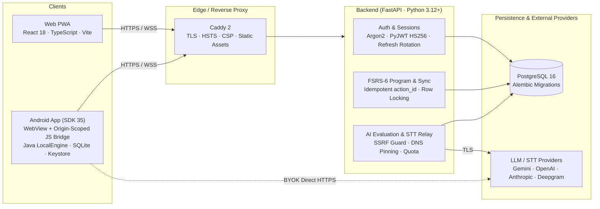

# LeitnAIr — AI Vocabulary Coach

> **Showcase Repository** — Public portfolio overview (architecture, UI previews, and engineering highlights).  
> Source code is maintained in a private repository; live walkthroughs are available on request for technical interviews.

LeitnAIr is a cross-platform (**Web App** + **Native Android**) vocabulary learning system built around **FSRS-6 spaced repetition**, **local study**, **BYOK / hosted AI answer evaluation**, and **real-time speech-to-text**.

---

## Visual Preview

<table>
  <tr>
    <td width="64%" valign="top">
      <strong>Desktop PWA — FSRS Study &amp; Self-Assessment</strong>  
      
    </td>
    <td width="36%" valign="top">
      <strong>Android App — Local Engine &amp; Evaluation</strong>  
      
    </td>
  </tr>
</table>

---

## Key Capabilities

- **Cross-Platform FSRS-6 Parity (`Py-FSRS 6.3.3`)**: Identical scheduling math (`Again` / `Hard` / `Good` / `Easy`, stability, difficulty, due dates) implemented in both the Python backend and the native Java Android engine (`LocalStudy`), backed by parity tests.
- **Local Android Engine**: Ships the bundled dictionary into private Android SQLite storage on first launch. Guests and signed-in learners can study, import personal CSV/JSON v2 word lists, and grade answers without an internet connection, with conflict-aware cloud sync.
- **Flexible Answer Evaluation**:
  - **Self-Assessment / Offline Rules**: Zero-cost, zero-network fallback with deterministic grading.
  - **Hosted Premium Evaluation**: Authenticated server-side evaluation with subscription & daily regional quota enforcement.
  - **Bring Your Own Key (BYOK)**: Supports Gemini, OpenAI, Anthropic, and custom OpenAI/Anthropic-compatible HTTPS endpoints. On Android, personal keys are encrypted at rest using **Android Keystore (AES-256-GCM)** with cloud backup disabled.
- **Real-Time Voice Recall**: Live WebSocket audio streaming to Deepgram/Groq STT with waveform-driven microphone feedback, interim transcripts, and explicit user submission.
- **Personal Word Lists**: Validated CSV & JSON v2 import pipeline with preview before commit, per-account isolation, and additive personal meanings.

---

## System Architecture

---

## Security & Engineering Highlights

| Area | Implementation |
|---|---|
| **SSRF & Custom Endpoint Protection** | Enforces public HTTPS (port 443), blocks private/loopback/link-local/metadata IPv4 & IPv6 ranges, disables redirects & proxies, pins validated DNS addresses, and bounds response sizes (both backend & Android OkHttp). |
| **Authentication & Session Lifecycle** | Argon2id password hashing, short-lived `HS256` JWTs (`PyJWT`), one-time rotating refresh tokens with reuse detection (revoking all user sessions on replay), and server-side `/auth/logout` revocation. |
| **Android Data Isolation** | Separate SQLite databases for guest vs. signed-in accounts, `allowBackup="false"`, `dataExtractionRules` excluding cloud/device transfers, `usesCleartextTraffic="false"`, and R8/ProGuard release minification. |
| **Idempotency & Concurrency** | Per-user row locking (`lock_user`), client-generated `action_id` deduplication across study attempts and device evaluations, and unified cross-endpoint daily AI quota tracking. |
| **Automated Verification** | **351** backend tests (`pytest`, `ruff`, `mypy --strict`, import architecture check), **97** frontend tests (`node --test`, TS architecture check, Vite build), and **0** known dependency vulnerabilities (`osv-scanner`). |

---

## Tech Stack

- **Frontend / PWA**: React 18, TypeScript, TanStack Query, Vite 7
- **Android**: Java 17, Android SDK 35 (`minSdk 26`), AndroidX WebKit (`WebMessageListener`), OkHttp 4.12, Android Keystore, SQLite
- **Backend**: Python 3.12+, FastAPI, SQLAlchemy 2, Alembic, `fsrs==6.3.3`, `PyJWT`, `argon2-cffi`, `httpx`, `websockets`
- **Infrastructure**: PostgreSQL 16, Caddy 2, Docker Compose (non-root, `read_only`, `cap_drop: ALL`, `no-new-privileges`)

---

## Source Code Availability

This repository is intentionally maintained as a **showcase** without application source code. If you are reviewing this project for a role and would like a guided code walkthrough or architecture deep-dive, feel free to reach out.
